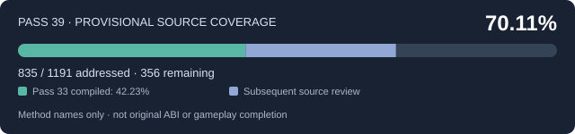

# Raft Pirates

[](docs/REMAINING.md)

**Pass 43 source inventory: 912/1191 (76.57%)** original method names addressed; 279 still listed as missing. Includes partial adapters and already-present names reviewed since the last compiled measurement. **Last measured host archive: 503/1191 (42.23%, Pass 33).** Neither figure establishes original ABI or gameplay parity. [Per-class matching status](docs/MATCHING_STATUS.md). [Remaining methods and priorities](docs/REMAINING.md).

An unofficial C++ source reconstruction of Raft Pirates for research and game preservation, built on [HydraLegacy](https://github.com/mlnitoon2/HydraLegacy). The project is not the recovered original source and is not a complete or binary-equivalent replacement. Original Java classes and resources are supplied by a locally available, compatible APK; they are not distributed by this repository.

## Build for Android

Requires an Android SDK, NDK r28c (28.2.13676358), CMake 3.22.1, Python 3 and a JDK for SDK tooling. Clone the two repositories side by side:

```sh
git clone https://github.com/mlnitoon2/HydraLegacy.git
git clone https://github.com/mlnitoon2/RaftPirates.git
cd RaftPirates
python build_arm64.py --sdk /path/to/android-sdk
```

`--install-tools` installs the required NDK and CMake through the existing SDK manager. `--hydra` selects an alternative engine checkout; `--minimal` disables optional Lua and FreeType adapters. The native build targets API 23, static libc++ and a 16 KiB maximum ELF page size. Output:

```text
out/lib/arm64-v8a/libraftpirates.so
```

The build checks the ARM64 ELF header and required JNI symbols. The library is intended for `lib/arm64-v8a/libraftpirates.so` in a compatible APK. APK packaging, Java compatibility changes and signing are outside the scope of the native build.

The [Android workflow](.github/workflows/android.yml) compiles both repositories, validates the result and publishes the rebuilt `libraftpirates.so` at the repository root after a successful build. [Build history](https://github.com/mlnitoon2/RaftPirates/actions).

### Other Android ABIs

`build_arm64.py` defaults to `arm64-v8a` and also accepts `--abi armeabi-v7a`, `--abi x86`, and `--abi x86_64`. Output is isolated in `out/lib/<abi>/libraftpirates.so`; the script checks the ELF class, machine and required JNI exports for that ABI. CI still publishes ARM64 only. Other targets are configured but have not been tested on devices.

## Network configuration

The authentication endpoint is read at runtime from `assets/xml_resources/properties.xml` in the APK:

```xml
<Properties>
    <Property key="SERVER_IP" value="https://auth.example.org/" />
    <Property key="admin" value="false" />
</Properties>
```

A bare hostname defaults to HTTPS. A complete HTTP(S) URL or an explicit `auth.php` URL is accepted. The XML property is the sole authentication endpoint configuration; there is no compile-time override. The original `MyLib.getAuthURL()` separately returns the website base recovered from the ARM32 binary.

Authentication uses the legacy BBB `auth.php` request and the returned `bbbId`, `sessId` and `serverIp`. The existing SmartFox Java SDK connects to that game host on port 9933 and logs in to the `RaftPirates` zone. A cold launch displays the splash and loading/login resources, resumes a saved session or opens login, and processes the initial world and resource manifest before displaying the Set Sail title. Set Sail enters the already-loaded game. Gameplay requires a current login attempt and valid player and ocean snapshots. The SDK login event is preferred; preservation servers that deliver both world packets before the native login callback can complete application-level initialization while the SDK transport is connected. Server authentication and permissions remain the server’s responsibility. See [networking and startup](docs/STARTUP_AND_GAMEPLAY.md).

The historical endpoints are not guaranteed to be operational. Use authorized test servers and test-only accounts. Legacy GET authentication includes credentials in the URL; HTTPS is recommended, and no automatic downgrade to HTTP is performed. Plain HTTP requires a compatible Android network policy. Credentials and private server URLs must not be committed.

## Implemented functionality

| Subsystem | Status |
|---|---|
| Startup | Original asset-based splash, title, loading, email, registration and status menus |
| Networking | BBB authentication, SmartFox JNI handoff, typed extension requests, initial packet queue, disconnect cleanup and SDK keep-alive |
| Player state | Static libraries, player snapshot, inventory, blueprints, raft and component state |
| Gameplay | Partial construction, repairs, travel, diving, discovery, shop and quest interfaces |
| Combat | Sonar and boss markers, encounters, battle placement, dice requests, damage updates and original battle XML controls with partial native action bindings |
| Engine | Software rendering, original assets, animation, menu layout and localization through HydraLegacy |
| Android bridge | 94 native declarations matched; some callbacks are explicit unsupported stubs |

The client has no offline play, demo fleet or simulated combat. Password recovery opens the service’s `lost_password.php` page; the service must implement it. The optional `admin` property defaults to false and controls `isCheatEnabled()` locally, not server permissions. Facebook, complete original menu/Lua behavior, full multiplayer and boss progression remain incomplete. See [multiplayer](docs/MULTIPLAYER.md), [HUD](docs/HUD.md), [class reconstruction](docs/CLASS_RECONSTRUCTION.md) and [port notes](docs/PORT_NOTES.md).

## Test on desktop

Requires C++17, CMake, Ninja, zlib, Expat, libpng and a JDK for JNI tests. Optional Lua and FreeType are provided by the engine build configuration.

```sh
cmake -S . -B build -G Ninja -DCMAKE_BUILD_TYPE=Release -DHYDRA_DESKTOP_JNI=ON
cmake --build build --parallel
ctest --test-dir build --output-on-failure
python tests/java/smoke.py build/libraftpirates.so /path/to/original.apk
```

The smoke test uses Java SDK and in-process URL connection doubles without opening any listening socket or altering the APK property. `-DRAFT_ASSET_ROOT=/path/to/extracted/assets` enables original-asset integration tests. See [asset preparation](docs/ASSETS.md) and the [engine build guide](https://github.com/mlnitoon2/HydraLegacy/blob/main/docs/BUILDING.md).

These tests verify host behavior and protocol fixtures, not live multiplayer, Android device compatibility or server availability. Coverage is method-name overlap only.

## Project layout

- `include/rp/`, `src/`: portable game state, protocol handling and views.
- `src/GameRuntime.cpp`: platform-independent application lifecycle and session orchestration.
- `tests/`: native regressions and desktop Java integration tests.
- `tools/`: asset and JNI inventory utilities.
- `evidence/`, `docs/`: reconstruction evidence and design notes.

Platform services and the legacy Android JNI exports live in HydraLegacy; its separate SFS library provides the Java SDK adapter. The game accesses rendering, audio, storage, authentication and transport through `sys::platform::Services`. The repository publishes only rebuilt native output, not the original proprietary binaries, scripts or art. Raft Pirates and Hydra belong to their respective rights holders. This project is unofficial; no license for the new reconstruction code has been selected.

### Saved login and static libraries

After successful authentication and receipt of valid player data, the client stores the issued session token, BBB ID, returned game-server host and configured authentication endpoint in application-private storage. Saved sessions resume automatically during startup loading, before the title is displayed. Expired sessions fall back to login; explicit logout removes the saved session. No password is saved. The historical encrypted save format has not been reconstructed.

Validated complete static-library snapshots are cached in application-private storage, scoped to the authentication endpoint and game host. The stored timestamp is sent as `last_updated` on the next login. Incomplete or unreadable caches are not used.
